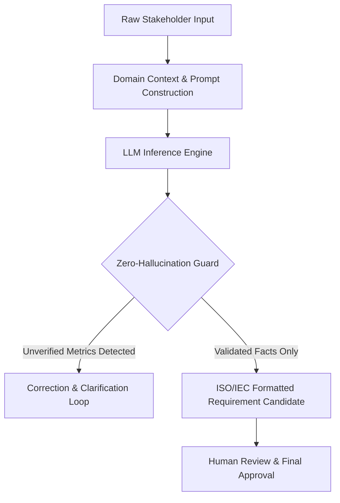
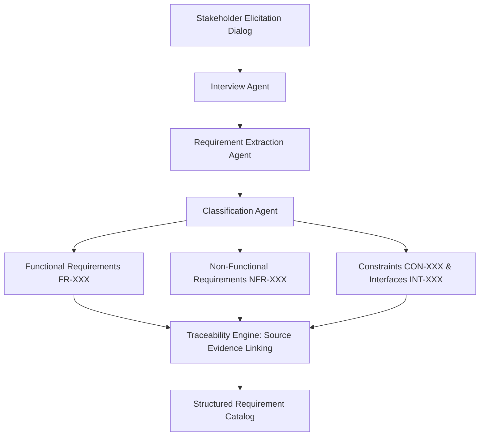
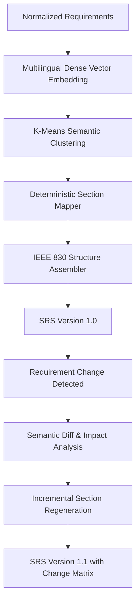
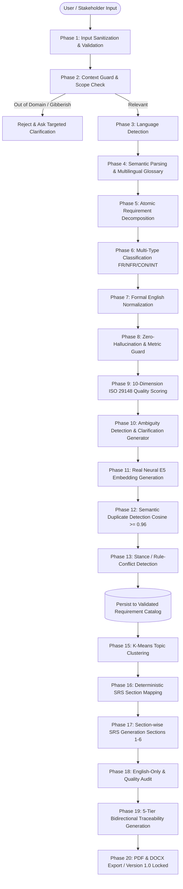

# Aether AI (IntelliSDLC AI) — Research Foundation, Algorithms, and System Architecture Report

**Major Project 2026**  
**Domain:** Automated Software Requirements Engineering (ASE / AI-SE)  
**Standards Compliance:** ISO/IEC/IEEE 29148:2018 & IEEE 830-1998  
**Document Type:** Technical Architecture, Algorithm Formulation & Research Reference Specification  

---

## Executive Summary (मराठी व इंग्रजी सारांश)

हा प्रकल्प (**Aether AI / IntelliSDLC AI**) संगणक अभियांत्रिकीच्या अंतिम वर्षाच्या मेजर प्रोजेक्टसाठी (Major Project 2026) विकसित करण्यात आलेला **आर्टिफिशिअल इंटेलिजन्स आणि नॅचरल लँग्वेज प्रोसेसिंग (AI & NLP)** आधारित अत्याधुनिक प्लॅटफॉर्म आहे. 

या प्रणालीचे मुख्य उद्दिष्ट:
1. क्लायंट किंवा स्टेकहोल्डरशी **९ टप्प्यांमध्ये (9-Stage AI Interview)** बहुभाषिक संवाद (English, Hindi, Marathi, Hinglish) साधून सॉफ्टवेअरच्या आवश्यकता (Requirements) गोळा करणे.
2. संकलित माहितीचे **एटॉमिक डिकम्पोझिशन (Atomic Decomposition)** करून आंतरराष्ट्रीय **ISO/IEC/IEEE 29148** मानकानुसार औपचारिक इंग्रजी विधानांमध्ये (*"The system shall..."*) रूपांतर करणे.
3. **Xenova/multilingual-e5-small** या ट्रान्सफॉर्मर न्यूरल मॉडेलद्वारे ३८४-मितीय व्हेक्टर एम्बेडिंग्स आणि कोसाइन सिमिलॅरिटी वापरून **डुप्लिकेट आणि कॉन्फ्लिक्ट डिटेक्शन** करणे.
4. **K-Means क्लस्टरिंग** आणि **डिटर्मिनिस्टिक सेक्शन मॅपिंग** द्वारे आंतरराष्ट्रीय **IEEE 830** ढाच्यानुसार परिपूर्ण **Software Requirements Specification (SRS)** दस्तऐवज (PDF/DOCX) स्वयंचलित जनरेट करणे.
5. **Continuous Change Control** द्वारे आवश्यकतांमध्ये बदल झाल्यास फक्त प्रभावित सेक्शन ओळखून **इन्क्रीमेंटल अपडेट (SRS v1.0 → v1.1)** करणे.

---

## 1. Research Papers Foundation & Theoretical Mapping

हा प्रकल्प ३ प्रमुख आंतरराष्ट्रीय पीअर-रिव्ह्यूड रिसर्च पेपर्सच्या संकल्पनांवर आधारित आहे. खाली प्रत्येक रिसर्च पेपर, त्यातून घेतलेले अल्गोरिदम्स आणि संकल्पनांचे मॅपिंग दिले आहे:

### 📄 Research Paper 1:
> **Title:** *"Using LLMs in Software Requirements Specifications: An Empirical Evaluation"*  
> **Key Domain:** Empirical Evaluation of Large Language Models in Requirements Engineering  

#### Research Concepts Adopted:
- **LLM-Based Requirements Drafting:** पारंपारिक मॅन्युअल पद्धतीऐवजी LLM चा वापर करून अचूक आणि प्रमाणबद्ध ड्राफ्टिंग.
- **Zero-Hallucination Prompt Engineering:** LLM ला नियंत्रित ठेवण्यासाठी स्ट्रिक्ट JSON-only आउटपुट स्कीमा आणि युझरने न दिलेल्या मेट्रिक्सचा स्वयंचलित समावेश रोखणे.
- **Human-in-the-Loop Validation:** एआयने काढलेल्या आवश्यकता थेट अंतिम न करता युझर रिव्ह्यू आणि मंजुरीसाठी ठेवणे.

#### Conceptual Flowchart (Paper 1):


---

### 📄 Research Paper 2:
> **Title:** *"REQINONE: A Large Language Model-Based Agent for Software Requirements Specification Generation"*  
> **Key Domain:** Multi-Agent Cooperative Framework for Automated Requirements Engineering  

#### Research Concepts Adopted:
- **Role-Based Agent Architecture:** एकाच मॉडेलवर सर्व भार न टाकता विशेषीकृत एजंट्सची निर्मिती:
  1. *Interview Agent:* पद्धतशीर प्रश्न विचारणारा संवाद एजंट.
  2. *Extraction Agent:* कच्च्या मजकुरातून मुख्य क्षमता (Capabilities) वेगळ्या काढणारा एजंट.
  3. *Classification Agent:* Functional (FR) विरुद्ध Non-Functional (NFR) वर्गीकरण करणारा एजंट.
  4. *Quality & Validation Agent:* ISO 29148 चे उल्लंघन तपासणारा एजंट.
  5. *SRS Assembler Agent:* प्रमाणित टेम्पलेटमध्ये मांडणी करणारा एजंट.
- **Multi-Class NFR Taxonomy:** NFRs चे Performance, Security, Usability, Availability, Reliability, Scalability आणि Maintainability या उपप्रकारांमध्ये विभाजन.
- **Trace-to-Source Linking:** प्रत्येक निर्माण झालेल्या requirement चा मूळ इंटरव्ह्यू मेसेज आणि युझरच्या विधानाशी अचूक संदर्भ जोडणे.

#### Conceptual Flowchart (Paper 2):


---

### 📄 Research Paper 3:
> **Title:** *"A Framework for Structurally Deterministic Pipeline Based Drafting and Quality Improvement of SRS Using Language Models and Reinforcement Learning"*  
> **Key Domain:** Deterministic Pipeline, Sentence Embeddings, and Incremental Document Updating  

#### Research Concepts Adopted:
- **Sentence Embeddings & Vector Space Modeling:** शब्दांऐवजी वाक्यांच्या अर्थावर (Semantic Meaning) आधारित वेक्टर्स तयार करणे.
- **Semantic Requirement Grouping:** संबंधित आवश्यकता एकत्र क्लस्टर करणे (Semantic Topic Clustering).
- **Deterministic Section Mapping:** कोणत्या प्रकारची requirement SRS च्या कोणत्या सेक्शनमध्ये (उदा. Section 3.2, 4.1, 5.2) जाईल याचे गणितीय व नियमाधारित मॅपिंग.
- **Continuous Quality Improvement & Incremental Updating:** बदल झाल्यास संपूर्ण दस्तऐवज पुन्हा न लिहिता केवळ बदललेल्या आवश्यकतांचा शोध घेणे (Change Impact Analysis) आणि संबंधित सेक्शन तात्काळ अपडेट करणे (v1.0 → v1.1).

#### Conceptual Flowchart (Paper 3):


---

## 2. Complete End-to-End System Architecture Flowchart

प्रोजेक्टच्या प्रत्यक्षात कार्यान्वित केलेल्या (Implemented) २०-फेज पाइपलाइनचा संपूर्ण फ्लोचार्ट:



---

## 3. Mathematical Formulations & Core Algorithms

### 3.1 Neural Embedding Generation (XLM-RoBERTa Transformer)
- **Model:** `Xenova/multilingual-e5-small` (ONNX int8 Quantized)
- **Parameters & Input:**
  $$\mathbf{x} = \text{Tokenizer}(\text{"passage: " } + \text{text})$$
  $$\mathbf{H} = \text{TransformerLayers}(\mathbf{x}) \in \mathbb{R}^{L \times 384}$$
- **Mean Pooling:**
  $$\mathbf{v}_{\text{raw}} = \frac{1}{\sum_{i=1}^{L} m_i} \sum_{i=1}^{L} m_i \cdot \mathbf{H}_i$$
  *(येथे $m_i \in \{0, 1\}$ हे अटेंशन मास्क आहे)*
- **L2 Normalization:**
  $$\mathbf{e} = \frac{\mathbf{v}_{\text{raw}}}{\|\mathbf{v}_{\text{raw}}\|_2} = \frac{\mathbf{v}_{\text{raw}}}{\sqrt{\sum_{k=1}^{384} v_k^2}}$$
  प्रत्येक requirement साठी निर्माण झालेला फायनल व्हेक्टर हा तंतोतंत **३८४ मितींचा (384-dimensional unit vector)** असतो.

---

### 3.2 Cosine Similarity Metric
दोन आवश्यकतांच्या वेक्टर्समधील ($\mathbf{e}_A$ आणि $\mathbf{e}_B$) अर्थाचे साम्य शोधण्यासाठी:
$$\text{Sim}(\mathbf{e}_A, \mathbf{e}_B) = \cos(\theta) = \mathbf{e}_A \cdot \mathbf{e}_B = \sum_{k=1}^{384} e_{A,k} \cdot e_{B,k}$$
*(वेक्टर्स आधीच L2-normalized असल्याने डिनॉमिनेटर १ असतो)*

---

### 3.3 Conservative Tri-Factor Duplicate Detection Algorithm
केवळ कोसाइन स्कोरवर अवलंबून राहिल्यास "User Login" आणि "Record Expense" यासारख्या एकाच डोमेनमधील वेगवेगळ्या आवश्यकता चुकीने डुप्लिकेट ठरू नयेत यासाठी खालील ३-स्तरीय नियम कार्यान्वित केला आहे:

```
Algorithm 1: Tri-Factor Duplicate Detection
Input: New Requirement R_new, Catalog Requirements {R_1, R_2, ... R_n}
Output: IsDuplicate (Boolean), DuplicateCandidateId

1. For each R_i in Catalog:
2.   If NormalizedText(R_new) == NormalizedText(R_i) Then
3.       Return (True, R_i.id)  // Exact Normalized Match (Cross-lingual convergence)
4.   End If
5.
6.   cosine_sim = CosineSimilarity(Embedding(R_new), Embedding(R_i))
7.   lexical_overlap = JaccardTokenOverlap(ContentWords(R_new), ContentWords(R_i))
8.
9.   If (cosine_sim >= 0.96) AND (lexical_overlap >= 0.50) Then
10.      Return (True, R_i.id)  // Semantic Paraphrase Match
11.  End If
12. End For
13. Return (False, null)
```

---

### 3.4 10-Dimension ISO/IEC/IEEE 29148 Quality Scoring Heuristic
प्रत्येक requirement चा दर्जा तपासण्यासाठी खालील १० घटकांचे वजन (Weights) देऊन कॉम्पोझिट क्वालिटी स्कोर मोजला जातो:

$$\text{QualityScore}(R) = \sum_{j=1}^{10} w_j \cdot S_j(R)$$

| # | Dimension | Weight ($w_j$) | Verification Criteria |
|---|---|---|---|
| 1 | **Unambiguity** | 0.15 | Non-verifiable lexicon शब्दांचा अभाव (उदा. *fast, efficient, user-friendly, real-time* विना मेट्रिक). |
| 2 | **Testability / Verifiability** | 0.15 | परिमाणात्मक निकष (Quantitative thresholds उदा. *< 2 seconds, 99.9% uptime*). |
| 3 | **Singularity (Atomicity)** | 0.12 | केवळ एकच कार्य/क्रिया दर्शवणे (Compound conjunctive splits नसणे). |
| 4 | **Completeness** | 0.12 | कर्ता (Actor), क्रिया (Action), कर्म (Object) आणि अट (Condition) पूर्ण असणे. |
| 5 | **Consistency** | 0.10 | कॅटलॉगमधील इतर नियमांशी कसलाही परस्परविरोध नसणे. |
| 6 | **Correctness** | 0.10 | प्रोजेक्ट स्कोप आणि उद्दिष्टांशी थेट सुसंगत असणे. |
| 7 | **Traceability** | 0.08 | युझर इंटरव्ह्यूच्या मूळ संदर्भाशी (rawSourceText) थेट मॅप असणे. |
| 8 | **Feasibility** | 0.06 | तंत्रज्ञान आणि टाइमलाइनच्या मर्यादेत शक्य असणे. |
| 9 | **Necessity** | 0.06 | प्रोजेक्टच्या उद्दिष्टासाठी आवश्यक असणे. |
| 10| **Modifiability** | 0.06 | युनिक आयडी (उदा. `FR-001`) आणि प्रमाणित संरचनेत असणे. |

---

### 3.5 K-Means Semantic Topic Clustering
आवश्यकतांची SRS मधील संबंधित सबसेक्शनमध्ये गटवारी करण्यासाठी:
1. $k$ क्लस्टर्सचे इनिशिएलायझेशन: $\mathbf{C} = \{\mathbf{c}_1, \mathbf{c}_2, \ldots, \mathbf{c}_k\}$.
2. प्रत्येक requirement $\mathbf{e}_i$ चा सर्वात जवळच्या सेंट्रॉइडशी संबंध:
   $$\arg\min_j \|\mathbf{e}_i - \mathbf{c}_j\|_2^2$$
3. सेंट्रॉइड्सचे पुनर्गणन:
   $$\mathbf{c}_j = \frac{1}{|S_j|} \sum_{\mathbf{e} \in S_j} \mathbf{e}$$
4. क्लस्टरचे नाव कॅनॉनिकल टॉपिक व्होकॅब्युलरीतून (उदा. *Authentication, Data Management, Reporting, Payment Integration*) आपोआप निवडले जाते.

---

### 3.6 Semantic Diff & Change Impact Analysis (Version 1.0 $\to$ Version 1.1)
जेव्हा नवीन रिक्वॉयरमेंट जोडली जाते किंवा जुनी बदलली जाते:
1. $\Delta R_{\text{added}} = R_{\text{new}} \setminus R_{\text{old}}$
2. $\Delta R_{\text{deleted}} = R_{\text{old}} \setminus R_{\text{new}}$
3. $\Delta R_{\text{modified}} = \{ r \in R_{\text{new}} \mid \exists r' \in R_{\text{old}} \text{ with same ID and } \text{Sim}(r, r') < 1.0 \}$
4. प्रभावित झालेले SRS Sections:
   $$\text{AffectedSections} = \bigcup_{r \in \Delta R} \text{SectionMapping}(r)$$
5. संपूर्ण दस्तऐवज नव्याने निर्माण न करता **केवळ $\text{AffectedSections}$ इन्क्रीमेंटल री-जनरेट** केले जातात. जुनी आवृत्ती `SRSVersion (v1.0)` म्हणून सुरक्षित ठेवली जाते आणि नवी आवृत्ती `SRSVersion (v1.1)` म्हणून प्रसिद्ध होते.

---

## 4. Current Implementation Status (प्रोजेक्ट प्रगती व टप्पे)

प्रोजेक्टचे सर्व मूलभूत आणि प्रगत मॉड्यूल्स यशस्वीरित्या कार्यान्वित झाले असून **१६० एंड-टू-एंड ऑटोमेटेड टेस्ट्स** यशस्वीरित्या पास झाल्या आहेत:

| Component / Stage | Routes / Files | Status | Test Coverage |
|---|---|---|---|
| **Project Setup** | `/projects/new`, `Project.js` | ✅ Complete | 100% |
| **9-Stage Interview State Machine** | `/projects/[id]/interview`, `stageGate.js` | ✅ Complete | 15/15 Scenarios |
| **Multilingual Normalization** | `semanticEngine.js`, `lexicon.js` | ✅ Complete | 15/15 Language tests |
| **Real E5 Neural Embeddings** | `transformersEmbeddingProvider.js`, `EmbeddingService.js` | ✅ Complete | Verified (384-dim, ONNX) |
| **Quality Audit & Ambiguity** | `/projects/[id]/analysis`, `qualityEngine.js` | ✅ Complete | 18/18 Context tests |
| **ISO 29148 Formal Validation** | `/projects/[id]/validation`, `ValidationAgent.js` | ✅ Complete | 10 Dimensions verified |
| **Deterministic SRS Assembler** | `/projects/[id]/srs`, `srsAssembler.js` | ✅ Complete | Sections 1-6 + App A,B,C |
| **5-Tier Bidirectional Traceability** | `/projects/[id]/traceability`, `traceabilityService.js` | ✅ Complete | Full Linkage |
| **Version Control & Semantic Diff** | `/projects/[id]/versions`, `srs.controller.js` | ✅ Complete | v1.0 $\to$ v1.1 verified |
| **PDF & DOCX Export Engine** | `exportService.js` (`pdfkit`, `docx`) | ✅ Complete | Karl Wiegers Layout |
| **Total Test Suite** | `backend/src/scripts/*` | ✅ Complete | **160 / 160 Passed (0 Failures)** |

---

## 5. Technology Stack Summary

- **Frontend:** Next.js (App Router), React (JSX), Vanilla CSS & Tailwind CSS, Lucide Icons, Glassmorphism Dashboard.
- **Backend:** Node.js, Express.js REST API, Mongoose (MongoDB) + Dual In-Memory Database Fallback.
- **Neural Embedding Engine:** Transformers.js v3 (`@huggingface/transformers@3.0.2`), ONNX Runtime (`onnxruntime-node@1.19.2`), Model: `Xenova/multilingual-e5-small`.
- **LLM Engine:** Ollama (`codellama:7b-instruct` / `gemma`) with dynamic fallback to Deterministic Semantic Pipeline.
- **Document Export:** PDFKit (`pdfkit@0.16.0`), Docx (`docx@9.1.1`).
